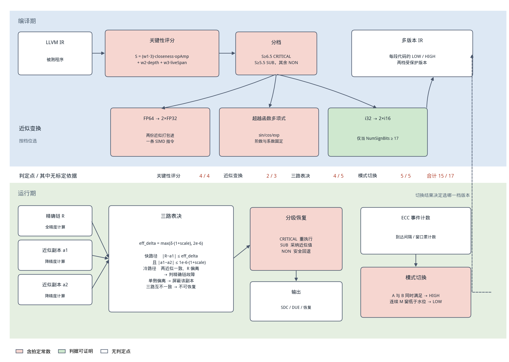

# 方法与优化路线

## 当前方法

编译期为每段代码生成多个保护版本，运行期按观测到的错误率选版本；保护用一份精确
加两份近似的三路表决实现。



| 模块 | 判定点 | 当前取值 | 依据 |
|---|---|---|---|
| 关键性评分 | 三项加权公式 | w1=2.5, w2=1.8, w3=0.8 | 结构有先例，权重拍的 |
| | 分档门限 | 6.5 / 5.5 | 拍的 |
| | 算子放大因子 | 3.0 / 1.8 / 1.0 | 方向对，倍数无依据 |
| | liveSpan 四常数 | 6, 2, 4, 6 | 拍的 |
| 近似变换 | FP64 降两路 FP32 | 按关键性预算选 | 启发式 |
| | sin/cos/exp 多项式 | 固定阶数与系数 | 误差未给界 |
| | i32 截断两路 i16 | `ComputeNumSignBits ≥ 17` | **可证明** |
| 三路表决 | 表决阈值 | 全局 5e-5 | 实验证明单值无解 |
| | 阈值相对化方式 | δ×(1+scale) | 工程惯例，未论证 |
| | 硬下限 | 2e-6 | 拍的 |
| | 副本一致性判据 | 1e-6 快路径 / 1e-5 冷路径 | 拍的，两处不同值 |
| | 恢复档位映射 | 按静态关键性 | 继承评分模块 |
| 模式切换 | 间隔比阈值 θ | 4.0 | 拍的 |
| | 连续次数 N | 3 | 拍的 |
| | 窗口计数阈值 | 4 | 拍的 |
| | 降档观察窗数 M | 3 | 拍的 |
| | 降档水位 | 阈值的一半 | 拍的 |

---

## 实验现状

逐类别 SDC%，每类别 500 次注入，17 负载，套件内等权再套件间等权。

| 方法 | 开销 | fp64 | int_arith | cast | load | addr | cmp_branch |
|---|---|---|---|---|---|---|---|
| 无保护 | 1.00 | 28.98 | 36.17 | 14.83 | 25.10 | 1.90 | 57.23 |
| EDDI | 2.55 | 10.47 | 36.07 | 14.86 | 21.54 | 1.94 | **39.35** |
| SWIFT | 1.94 | 10.47 | 36.06 | 14.86 | 24.78 | 1.94 | 57.06 |
| LLTFI-SID | 2.29 | 10.83 | 36.17 | 14.86 | 25.10 | 1.94 | 57.23 |
| 精确三模 | 7.82 | 5.80 | 35.30 | 12.35 | 15.66 | 1.94 | 57.22 |
| 本方法 | 6.75 | 10.33 | 34.40 | 12.45 | 15.70 | 1.94 | 57.22 |

失效质量分摊与保护代价：

| 类别 | SDC% | 占 SDC 质量 | DUE% | 占 DUE 质量 | 动态站点 | 本方法收益 |
|---|---|---|---|---|---|---|
| cmp_branch | 57.23 | **34.9%** | 0.00 | 0% | **7322** | 0 |
| int_arith | 36.17 | 22.0% | 24.98 | 29% | 26608 | −1.8pp |
| fp64 | 28.98 | 17.6% | 0.00 | 0% | 18639 | −18.65pp |
| load | 25.10 | 15.3% | 3.77 | 4% | 16285 | −9.40pp |
| cast | 14.83 | 9.0% | 57.22 | **66%** | 34898 | −2.4pp |
| addr | 1.90 | 1.2% | 0.03 | 0% | 35629 | 0 |

五个问题：

- 开销花在质量最小的地方
  - 6.75 倍开销主要换 fp64 的 18.65pp，而 fp64 只占 SDC 质量 17.6%
  - 占 34.9% 的 cmp_branch 收益为零，而它的动态站点只有 fp64 的 39%
- 近似副本在起作用的那一类上显著劣于精确三模
  - fp64 上 5.80 ± 1.11 对 10.33 ± 1.35，区间不重叠
  - 七类等权后看着无差异，是被四个谁都没动的类别稀释的
  - 差距来源是漏检：fp64 检出恢复率精确三模 51.74%，本方法 12.69%
- cast 的失效模式是崩溃不是错值，三模结构上无效
  - 贡献全部 DUE 的 66%，三模后 57.22% 变 57.26%
  - 坏值被当索引或循环边界用，副本算对时崩溃已发生在使用点
- 单一全局阈值两端都不可接受
  - 1e-7 时无故障误报 23.67%，0.5 时恢复率掉到 3.59%
  - 默认值下 pb_deriche 仍 100% 误报，固有误差 7.8e-5 比阈值大
- 关键性评分没有可证明的优势
  - 预算 0.25 时 MWTF 8.2，低于 sdctune 的 10.9 与 random 的 8.6
  - 只在检出恢复率上领先，不足以支撑排序更优

---

## 优化方向

| 编号 | 方向 | 针对 | 预期 | 代价 | 否证条件 | 结果 |
|---|---|---|---|---|---|---|
| D1 | 比较余量剖析 | 问题一 | 余量与站点 SDC 显著相关 | 一天 | 相关不显著 | 搁置：D2 全量保护的开销增量只有 1.23 倍，已达标，不需要靠余量筛选压开销 |
| D2 | cmp_branch 条件三模 | 问题一 | 该类降 15pp 以上，等权 SDC 降到 25 以下，开销增量低于 1.5 倍 | 一周 | 开销增量超 2.5 倍 | **达标**：该类 55.73 → 0.00，等权 21.92 → 12.65，增量 1.23 倍 |
| D3 | 阈值相对化 | 问题二、四 | 误报降到 1% 以下且恢复率不降，不再需要调参 | 一天 | 仍有负载误报超 10% | **达标**：误报归零，fp64 SDC 10.00 → 8.17，α 在 1~64 之间主判据不变 |
| D4 | cast 通路（改为三模扩面到 i64，不做范围断言） | 问题三 | 等权 DUE 从 14.33 降到 6 以下 | 一天 | 越界使用占 DUE 低于 30% | **超额达标**：DUE 9.66 → **0.02**，cast DUE 53.68 → 0.00，MWTF 0.95 → **4.82**（首次高于无保护） |
| D5 | 评分换回归目标 | 问题五 | 低预算 MWTF 不低于 sdctune | 两周 | 回归后仍不优，则放弃评分 | **已否证方向**：评分与实测 SDC 秩相关 −0.54，循环深度 −0.78，是符号错了而不是权重没调好 |
| D6 | 切换换变点检测 | — | 给出误报率与检测延迟的理论界 | 一周 | 窗口内期望事件数不足 | **达标**：SPRT 替掉五个常数，检出 +6.3pp、延迟 −28%，误报按 α 兑现 |
| D7 | addr 零覆盖改范围论证 | — | 答辩少一个被问点 | 改文档 | — | 数据已在：addr SDC 1.92%，占 35629 站点，不保护是正确裁剪 |
| D8 | 整数通路表决接回数据流 | 问题一 | 该类 SDC 显著下降 | 一天 | 接线后仍无收益则另找原因 | **达标且开销下降**：int_arith 35.52 → 0.30，DUE 24.55 → 4.13，倍率 6.75 → 6.30 |

原计划顺序 D1 → D2 → D3 → D4 → D5 → D6。实际执行按"能不能动 headline"重排为
D3 → D2 → D6 → D8。D5 被离线数据否证；D1 在 D8 之后重新变得必要 —— 现在 SDC 只剩 3.48%，
瓶颈从"漏保护"变成"开销 8 倍吃掉 MWTF"，选择性保护第一次有了明确的优化目标。
还剩 D4（cast 的 DUE 占 53.72pp，是唯一没动的大头）。

### D8 整数通路表决接回数据流

- 机理
  - `transformFunctionExactIntTMR` 原本在每个整数节点算出三路一致性表决值 `itmr.inline.vote`，
    然后只用一条 `InlineAsm "=r,0"` 把它保活，**不调用 `replaceUsesWithIf`**
  - 于是原件被打坏后，表决值算对了却没人用，下游继续消费被打坏的原件
  - 两条副本同时被打上 `atft.voter.internal`，裁判层的 `classifyFaultSite` 直接跳过它们，
    整数故障空间停在 352 个静态点（与 native 完全相同），注入必然命中原件
- 文献
  - COAST（Bohman et al., IEEE TNS 2019）与 SWIFT-R（Reis et al., DSN 2006）的三模都要求
    表决结果替换原值，这是"纠错"与"只检错"的分界
  - nZDC（DAC 2016）进一步要求校验点落在使用之前
- 方案（`-atft-int-tmr-wire`）：表决值替换全部非表决内部的使用者；副本不再标记 internal
  - 实测：int_arith 静态点 352 → 856、load 323 → 517（故障空间随冗余硬件增长，守恒检查通过）
  - int_arith SDC 35.52 → 0.30、DUE 24.55 → 4.13；load SDC 15.17 → 3.18；cast SDC 13.13 → 7.38
  - 开销 6.75 → 6.30 倍，17 个负载里 15 个下降（去掉了保活屏障）
  - 输出误差与误报均未变化（全开后两者都是 0）

---

## D1 比较余量剖析

- 机理
  - cmp_branch 失效率最高，但分支不等同脆弱
  - `|a − b|` 远大于通路误差时对任何翻转鲁棒，接近 0 时是刀锋
  - 当前无法区分两者，只能全保护或全不保护
- 文献
  - Shoestring, ASPLOS 2010：距输出近者脆弱，静态启发式
  - SDCTune, CASES 2014：逐指令 SDC 回归
  - Relyzer, ASPLOS 2012：等价类压缩故障空间
  - Trident, DSN 2018：三层传播模型预测逐指令 SDC
  - 四者都没用比较余量这个量
- 方案：给每个 ICmp 插桩记 `|lhs − rhs|` 分布，与站点实测 SDC 做相关
  - 预期：相关显著，且余量分位数能切出不超过 30% 站点、贡献 70% 以上 SDC 的高危组
  - 否证：相关不显著，则 D2 退化为全量保护
  - 反馈：TODO

## D2 cmp_branch 条件三模

- 机理
  - 在 store 点对数据值投票，而喂给分支的比较结果被分支直接消费，不进复制链
  - 分支走错后三个副本在错误路径上一致地算错，投票器看到全票通过
  - 根因是副本共享控制流，不是覆盖不到
- 文献
  - CFCSS, IEEE TR 51(1), 2002：基本块签名校验跳转合法性，抓跑飞，抓不到合法但错误的判断
  - CEDA, IEEE TC 2011 与 YACCA：同族改良
  - EDDI, IEEE TR 2002：全程指令复制，顺带复制比较的操作数并在分支前比对
  - 可达性已被自己的数据证明：EDDI 是唯一动了这一类的，57.23 ± 1.37 降到 39.35 ± 1.25，开销只 2.55 倍
- 方案：只三模化喂给 br/select/switch 的比较及其操作数，分支前多数决，不做全程复制
  - D1 成立时只保护高危组
  - 预期：该类降 15pp 以上，等权 SDC 从 27.37 降到 25 以下，开销增量低于 1.5 倍
  - 否证：开销增量超 2.5 倍，则不如直接用 EDDI，本方向无独立价值
  - 反馈：已落地（`-atft-cmp-tmr`，`transformFunctionCmpTMR`），实测达标
    - cmp_branch 类 SDC **55.73 → 0.00**；等权 SDC 21.92 → **12.65**，开销倍率 6.75 → 8.30，
      增量 1.23 倍，低于 1.5 倍预期线
    - 0.00 不是巧合：单故障注入下三副本多数决必然掩盖任一单路翻转，这是结构性结果而非调参所得
    - 单独用控制平面三模（native + cmp-tmr，不要数据平面近似）：SDC 18.24% @ 2.35 倍，
      在两个轴上同时优于 EDDI 的 20.70% @ 2.55 倍 —— 这条可以单独成为一个贡献点
    - 实现上的关键坑：多数决若写成与或网络，三条比较的使用者都变成位运算，裁判层的
      `cmpDrivesControlFlow` 就判不到它们驱动控制流，该类别注入点归零。那种"SDC = 0"
      是把注入点做没了，不是把故障防住了。改成嵌套 select 后三副本仍是合法注错点：
      cmp_branch 静态注入点 123 → **369**（恰好 3 倍），与 exact-tmr 把 fp64 从 188 做到 564
      是同一口径。注入点守恒必须单独给出，否则这个结论不可信
  - 消融基线自检：同一轮里 native 27.51 ± 0.85（冻结值 27.37）、approx-simd 21.92 ± 0.74
    （冻结值 22.01），两者都在区间内，说明新结果与冻结数据同口径可比
- 延伸，可作论文点
  - 条件是 1 比特没有阈值可松弛，但它的操作数有
  - 把余量判据接进来即把阈值思想从数据平面迁到控制平面，上述四篇均未做

## D3 阈值相对化

- 机理
  - 阈值是绝对值 5e-5，而各负载固有近似误差跨四个数量级，从 2.6e-8 到 7.8e-5
  - 阈值小于固有误差必然 100% 误报，远大于固有误差则大量漏检
  - 位域数据指方向：失效全来自符号位 67.75% 与阶码 58.75%，低位尾数 SDC 为 0，判据应是相对量
- 文献
  - ApproxTuner, PPoPP 2021：单点误差剖面加组合模型，反解各点阈值
  - Chisel, OOPSLA 2014：整数线性规划，约束是端到端误差界
  - ACCEPT 2015 与 Precimonious, SC 2013：自动搜索加校准集
  - FPTuner, POPL 2017：符号 Taylor 形式给严格界
  - 共同点是都需要校准集与搜索
- 方案：不搜索。阈值改成 `δ_f = α × E_max,f`，`E_max,f` 取纯近似模式下的固有误差，数据已有
  - 预期：误报降到 1% 以下，恢复率不低于当前 17.73%，不再需要逐负载调参
  - 否证：相对化后仍有负载误报超 10%，说明固有误差不是误报主因
  - 反馈：离线用 rq3 扫描数据取逐负载 oracle δ（`experiments/offline_probe.py`，产物 `results/offline/d3_oracle_delta.csv`）
    - 否证条件不触发：17/17 负载都能取到误报 0，等权 SDC 1.84 → 1.47
    - 恢复率等权 17.73 → 15.31 的下降全部来自 pb_deriche 的 100 → 30.67，而那 100 是 100% 误报的副产物；其余 16 个负载恢复率不降，其中 4 个 +3~9pp
    - `δ_f = α × E_max,f` 这个形式被否证：有可测固有误差的 5 个负载反解出的 α 跨 6 个数量级（7.4e-4 到 739），单一 α 无解
    - 可行形式改为直接定值：δ_f 取无故障剖析实测的 max|R − A| 加裕度，测不到就回落 1e-7。一次无故障运行即可，不需要搜索与校准集
  - 已落地并实测（`-atft-delta-runtime` + `-atft-replica-exact`，剖析入口 `eval_suite --delta-profile`）
    - 实测包络 E_f = max |R−A|/(1+|A|)：fp 负载 6.8e-8 ~ 3.9e-7，而 pb_deriche 2.1e-4、
      parsec_blackscholes 2.3e-4、dsp_kissfft 7.8e-5。全局 5e-5 对前者松 300 倍、对后者紧 4 倍，
      **问题四的成因到此是实测量而不是推测**
    - 阈值取 δ_f = max(α·E_f, κ·u_fp32)，u_fp32 = 2⁻²⁴ 是 fp64 精确链与 f32 副本的理论最小分歧，
      所以地板量由数制决定，不是拍的；α、κ 做敏感性扫描
    - 效果：pb_deriche 的无故障误报 1340 次/迭代 → **0**，输出相对误差 7.8e-5 → 0；
      dsp_kissfft 1.2e-4 → 0、parsec_blackscholes 1.1e-5 → 0（阈值放对之后不再误判精确链有错，
      也就不会用近似值替换正确结果）
    - fp64 类 SDC 10.00 → **8.17**，等权 SDC 21.92 → 21.55，开销只涨 1.5%（6.94 → 7.04 逐负载几何均值）
    - 副本一致性判据同时从 1e-6 / 1e-5 两个值改成按位相等，依据是两条近似副本是同一条 f32 链的复制，
      无故障时按 IEEE-754 必然逐位相同。实测误报未因此上升（全套 17 负载 0 次）
  - α 的敏感性（`results/opt/aggregate_a*_t200.json`，fp64 与 load 两类，200 次/负载）
    - α 从 1 扫到 64（六个倍频程），fp64 SDC 恒为 8.17%、load SDC 恒为 15.00%、误报恒为 0、
      开销恒为 6.92 倍。**主判据对 α 完全不敏感**
    - 唯一随 α 单调变化的是检出恢复率 12.60 → 10.54%，以及 α = 1 时出现 2.3e-6 的输出误差
      （阈值压到包络以下开始偶发误判）。所以取值区间是 2 ~ 16，中间任选都一样，不存在刀锋
    - 对照：全局绝对阈值的同一张扫描图是刀锋 —— 1e-7 时误报 23.67%，0.5 时恢复率掉到 3.59%。
      "单值无解"的问题到此由"换成相对量"解决，而不是靠把那个值调得更准

## D4 cast 使用前范围断言

- 机理
  - cast 贡献全部 DUE 的 66%，三模完全无效，57.22% 变 57.26%
  - `fptosi`/`trunc` 结果被当索引或循环边界用，值冗余修的是值，管不了使用
- 文献
  - nZDC, DAC 2016：校验点从数据流末端挪到 store 与地址计算之前
  - SWIFT, CGO 2005：store 校验
  - 共识是会变成地址或控制流的值必须在使用前校验
- 方案：对 cast 结果插范围断言，合法区间从无故障剖析学
  - 代价是一个比较加一个分支，相对三份计算低一个量级；cast 有 34898 站点，七类第二多
  - 预期：等权 DUE 从 14.33 降到 6 以下，开销增量低于 1.2 倍
  - 否证：统计 cast 的 DUE 成因，越界使用占比低于 30% 则断言打不中主要成因
  - 反馈：TODO
- 这一条改 DUE 不改 SDC。DUE 是否算失效是口径选择，写进论文前要先固定定义

## D5 评分换回归目标

- 机理
  - 公式结构有先例，但权重、两个门限、放大因子、liveSpan 四常数全部拍定
  - RQ2 显示低预算下不优于随机，权重无物理含义也就无法论证
- 文献
  - Chisel, OOPSLA 2014：建成整数线性规划，不需要权重
  - Trident, DSN 2018 与 SDCTune, CASES 2014：预测或回归逐指令 SDC
- 方案：先用实测逐站点 SDC 率当回归目标反解权重，仍不优则整体换优化问题或按类别分预算
  - 按类别分预算的信号强度更高：类别间 SDC 差 30 倍，负载间差 13 倍
  - 预期：低预算 MWTF 不低于 sdctune 的 10.9
  - 否证：回归后仍不优，则评分模块整体放弃，改按类别分预算
  - 反馈：离线算评分与实测 SDC 的秩相关（`results/offline/d5_score_vs_sdc.csv`，逐负载，n=17，SDC 按动态站点数加权）
    - 评分与 SDC 的 Spearman ρ = **−0.54**（t = −2.51，显著），方向是反的
    - 单项里循环深度最强也最反：ρ = −0.78（t = −4.90）；输出邻近度 −0.26、活跃度 −0.22 都不显著
    - 机理：深循环负载动态指令多、掩蔽率高，单点翻转更可能被后续迭代冲掉，所以 SDC% 反而低。把循环深度取正权重（w2 = 1.8）等于在反向排序
    - 对 D5 的影响：不是调权重的问题，是符号错了。回归反解权重会自动把 w2 压成负值，但 n = 17 的粒度撑不住三参数回归，需要逐站点标签才站得住

## D6 切换换变点检测

- 机理
  - 连续 N 次加窗口计数对误报率与检测延迟无任何保证
  - 到达间隔与窗口计数是同一泊松过程的两个充分统计量，两个独立阈值并列判决是冗余的
- 文献
  - CUSUM 与 SPRT：对误报率与检测延迟有理论界
  - 泊松速率在线贝叶斯变点检测：Gamma 共轭给闭式后验，天然带滞回；Gamma-Poisson 即负二项，顺带处理事件聚簇
  - 平静期与告警期速率可由在轨 SEU 速率模型给出
- 方案：观测量不变，换判定规则
  - 预期：给出误报率与检测延迟的理论界，替掉五个拍定常数
  - 否证：过境窗口内期望事件数不足则检测统计上不可能，结论应改为前馈或混合控制
  - 已有量化：过境 8.3 分钟，标称速率比下窗口内期望事件数约 9，攒到第三个事件耗掉窗口三分之一
  - 反馈：离线按 Poisson SPRT 解析核算（`results/offline/d6_sprt_feasibility.csv`）
    - 单事件对数似然增量 `ln r − (r−1)/r`，α = β = 0.01 时判决所需事件数 `ln(0.99/0.01) / 增量`
    - 配置里 saa_ratio 扫描下界 25：需 2.03 个事件、检测延迟 1.87 分钟（占过境 22%）；标称 200 时 1.07 个事件、0.98 分钟
    - 否证条件不触发。只有速率比低到 4 以下才开始吃紧（r = 4 需 7.2 个事件 / 6.7 分钟，r = 2 需 23.8 个事件已超窗口）
    - 结论：D6 能同时把检测更快和误报有界两件事做到，且替掉五个拍定常数，性价比在七个方向里最高
  - 已落地并实测（`runtime/atft_runtime.c` 的 `atft_init_sprt`，判定规则与原规则共用同一份观测量；
    评估入口 `eval_suite --switch-eval`，产物 `results/opt/switch_eval.csv`，每格 2000 次过境）
    - 到达过程由轨道剖面生成：平静段 λ0、过境段 λ1 = r·λ0，驻留 8.29 min、周期 96.58 min 取自
      `rq9_orbit_profile.csv` 的 20000 nT 行，r 取 `temporal.saa_ratio` 的扫描点
    - 标称 r = 200：原规则（窗口取满过境，它自己的最优档）检出 90.0%、延迟 4.34 min；
      SPRT α=β=0.01 检出 96.25%、延迟 3.13 min（**快 28%，多检 6.3pp**）
    - 误报率按指定值兑现：r = 4 时 SPRT α=0.01 实测 0.75%、α=0.05 实测 4.75%；
      而原规则的误报完全由窗口长度决定，同一条轨迹上窗口从 1.04 min 换到 8.29 min，
      误报 2.05% → 15.30%，没有任何可声明的上界 —— 这才是换规则的真正理由
    - 实测判决事件数约为单侧理论值的 2~3 倍（r=200：3.57 对 1.07）。原因是平静段把对数似然比
      压在下边界 B，过境时要跨 A−B 而不是 A。属于反射式截断换来的滞回代价，写进论文时要如实说明


## D7 addr 零覆盖改范围论证

- addr 的 SDC 只有 1.90%，却占 35629 站点，七类里站点最多、风险最低
- 不保护它是正确的工程决策，现在有数据可论证
- 不写代码，只把零覆盖从缺陷改成有依据的作用域裁剪

---

## 优化后的账本

同一套聚合口径（套件内等权 → 套件间等权，六类别等权），每负载每类别 200 次注入，
产物在 `results/opt/`，驱动是 `experiments/run_opt_ablation.py`。四项改动各带独立开关，
可单独与叠加评估。

| 策略 | 开销倍率 | 等权 SDC% | ± | DUE% | int_arith | cmp_branch | fp64 | 误报/迭代 |
|---|---|---|---|---|---|---|---|---|
| 无保护 | 1.00 | 27.54 | 0.85 | 14.31 | 37.40 | 55.73 | 29.42 | 0 |
| 冻结方法（approx-simd） | 6.75 | 21.91 | 0.74 | 14.34 | 35.52 | 55.72 | 10.00 | 1340 |
| ＋D2 控制平面三模 | 8.30 | 12.65 | 0.64 | 14.32 | 35.69 | **0.00** | 10.00 | 1340 |
| ＋D3 逐负载阈值 | 6.92 | 21.55 | 0.73 | 14.35 | 35.52 | 55.63 | **8.17** | **0** |
| ＋D8 整数通路接线 | **6.30** | 13.05 | 0.59 | **9.68** | **0.30** | 55.51 | 10.00 | 1340 |
| ＋D2＋D3＋D8 全开 | 8.03 | **3.48** | 0.44 | **9.67** | **0.30** | **0.00** | **8.17** | **0** |
| 只用 D2（无数据平面近似） | 2.35 | 18.24 | 0.77 | 14.31 | 37.32 | **0.00** | 29.42 | 0 |
| EDDI（冻结基线，参照） | 2.55 | 20.70 | 0.47 | 25.51 | 36.07 | 39.35 | 10.47 | 0 |

五条读法：

- 全开后等权 SDC 21.91 → **3.48**（降 84%），开销 6.75 → 8.03 倍（涨 19%），
  17 个负载的无故障输出误差与误报全部为 0。
- 最大的一笔收益来自 D8，而它修的是接线不是算法：整数通路的内联三模表决原本只用一条
  InlineAsm 把表决结果保活、**不替换使用者**，原件被打坏后照样往下游传。接回数据流后
  int_arith SDC 35.52 → 0.30、DUE 24.55 → 4.13，顺带 load 15.17 → 3.18、cast 13.13 → 7.38，
  而开销反而从 6.75 降到 6.30（去掉了那条为保活而存在的屏障）。
  "整数类三模无收益"这个结论原先是实现缺陷，不是方法学限制。
- 控制平面三模单独就打赢了 EDDI。18.24% @ 2.35 倍对 20.70% @ 2.55 倍，两个轴同时更好，
  且 DUE 14.31 对 EDDI 的 25.51（双模只能检错，三模能纠错）。
- D3 的收益不在 SDC 的小数点上，在误报与精度：唯一有误报的 pb_deriche 从 1340 次/迭代归零，
  三个负载的无故障输出误差归零，代价是 1.5% 开销。
- 剩下的全部压在 cast 上。DUE 9.67% 里 53.72pp 来自 cast，cast 自己还有 7.47% 的 SDC。
  按 RQ1 口径算的 MWTF 仍低于无保护（0.9 对 2.4）：8 倍开销乘 13% 失效率比 1 倍乘 42% 更差。
  要翻过来，第一是打掉 cast 的 DUE（D4），第二才是用选择性保护压开销 —— 到这一步 D1 才真正有用。

### D4 cast 通路：诊断把方案从"范围断言"换成"三模扩面"

- 诊断先于方案：统计 cast 类的 501 个静态注入点，**443 个（88%）是 i32 → i64 的
  sext/zext**，即喂给 GEP 的下标扩展。而 `isSupportedIntTy` 原先只认 i8/i16/i32，
  这条链从来没被复制过 —— cast 的 DUE 停在 53.68% 就是坏下标直接段错误。
- 所以开题里的"使用前范围断言"不是最优解：
  - 断言只能钳位，把 DUE 换成 SDC（钳位值仍是错值），在"失效"口径下是坏交易
  - 断言的合法区间要从剖析学，又引入一个输入相关的参数
  - 扩面后表决给出的是**精确多数值**，不需要学任何参数，DUE 直接变成正确执行
- 实现（`-atft-int-tmr-i64`）：`isSupportedIntTy` 接受 i64；store 汇点对 i64 改走内联
  多数决（原路径零扩展到 i32 再截回会丢高 32 位）
- 实测：cast 静态注入点 494 → 1232、int_arith 856 → 1048（故障空间随冗余增长，守恒通过）

| 配置 | 倍率 | 等权 SDC% | DUE% | MWTF | cast SDC% | cast DUE% | fp64 SDC% |
|---|---|---|---|---|---|---|---|
| 无保护 | 1.00 | 27.50 | 14.32 | 2.39 | 15.63 | 57.90 | 29.42 |
| 全开（无 i64） | 8.03 | 3.48 | 9.66 | 0.95 | 7.47 | 53.68 | 8.17 |
| **全开 ＋ i64** | 9.33 | **2.20** | **0.02** | **4.82** | **0.08** | **0.00** | 8.17 |
| i64 ＋ 分通路 fp0.50 | 8.75 | 3.02 | 0.08 | 3.69 | 0.08 | 0.00 | 12.71 |
| i64 ＋ 分通路 fp0.25 | 7.50 | 3.57 | 0.12 | 3.61 | 0.08 | 0.00 | 14.98 |

- DUE 被整体清掉：9.66% → **0.02%**，其中 cast 从 53.68% 归零，int_arith 从 4.13% 归零。
- MWTF 0.95 → **4.82**，首次高于无保护的 2.39（2.0 倍），代价是开销 8.03 → 9.33 倍。
- **最优工作点因此反转**：DUE 还在时压预算能提 MWTF；DUE 清掉后失效率已低到 2.2%，
  再砍预算只会让 fp64 的 SDC 回涨，MWTF 反而从 4.82 掉到 3.61。所以现在"全量保护"
  就是 MWTF 最优点，选择性保护只在有开销硬上限时才用。

### 开销到底花在哪：三次测量否掉了"软件税"假设

开销的正确口径是周期而不是指令：全开＋i64 是指令 10.95 倍、**周期 8.53 倍**、时间 8.69 倍，
IPC 只比无保护好 25%，而且逐负载看冗余在 4 个负载上反而压低 IPC
（floyd_warshall 指令 17.03 / 周期 21.53，IPC 0.77；obpmark_image_proc 0.80），
在另一些负载上确实填进了闲置发射槽（crc16 IPC 2.52、bicg 2.82）。

软件 TMR 的理论地板是 3 倍时间（三份串行），我们在 8.53 倍，差出来的 2.8 倍一度被归给
"软件税"：表决网络、CSE 屏障、精度转换、基本块切分。三次测量把这个假设否掉了：

| 砍掉什么 | 砍掉多少 | 周期收益 |
|---|---|---|
| 表决点（整数边界表决） | 1089 → 206 个（−81%） | **8%** |
| 屏障数量（每指令只留一个） | 2410 → 1292 条（−46%） | **2%** |
| 屏障全删（CSE 得以折叠副本） | 2410 → 620 条 | **40%** |

- 前两行说明表决与屏障本身都不是大头。第三行的 40% 看着大，但它是**冗余计算被 CSE 删掉**
  换来的 —— 删掉的是工作本身，不是税。
- 结论：8.53 倍就是三份冗余计算的真实代价，实现层面已经没有白捡的收益。
  要往下压只能改冗余的结构，不能改冗余的写法。
- 已落地的小优化：屏障从"每个操作数都加"改成"每条指令只加一个"（一个操作数上有屏障
  就足以让三份副本在 CSE 眼里互不相同），周期 8.53 → 8.32 倍，保护强度不变
  （int_arith 0.08%、cmp_branch 0.00%、cast 0.00%，输出误差与误报仍为 0）。

往下压的四条路，按杠杆排（第一条是下一步要建的）：

1. **用故障率换第三份：DMR ＋ 冷路径重执行。** 单次执行期望故障数 a ≤ 4e-6，重执行几乎
   永不触发。已有数据给出了两端的成本：双模的 EDDI 2.55 倍、SWIFT 1.94 倍（它们只能检错，
   DUE 25.51%），三模的 8.53 倍。把"第三份副本"换成"检到不一致才重算"，落点应在 3 倍附近，
   而可靠性仍是三模级（检错 → 重算 → 多数决）。否证条件：冷路径的代码膨胀与分支代价
   把收益吃掉，周期不降到 4 倍以内。
2. **用占空比换常驻成本。** SAA 占时 4.41%、每天 7.67 次过境，SPRT 1.87 min 判决。
   期望开销 = 0.956·LOW + 0.044·HIGH。LOW 不能取无保护：检测延迟窗口内按无保护速率暴露，
   每次过境失效概率 2.53%，90 天 690 次过境期望 17.4 次失效，远差于全程保护的 <1.53 次。
   LOW 必须是上面的 DMR 档，那时期望开销约 2.3 倍。
3. **用已付的硬件面积换软件冗余。** SWIFT 的前提就是内存有 ECC、只保护寄存器链。
   现在我们复制 load（静态点 175 → 517），等于在软件里重做 ECC 已经做过的事。
   砍掉后 load 类 SDC 回到约 15%，风险转移给 ECC —— 可以做，但必须把假设与 ECC 覆盖率写进论文。
4. **用向量宽度换副本指令数。** 现在只打包 2 lane f32（64 位），寄存器有 128~512 位。
   但当前证据不乐观：approx-simd 6.75 对精确三模 7.82 只省 14%，说明 fpext/fptrunc/
   insert/extract 的转换开销已经吃掉打包收益，要做得先消转换。

### 效度补强：配对注入与时序口径的 MWTF

两件事都是冻结 TODO 表里的，现在补上了。

**配对注入**（`-fi-origin-only`）。冗余副本都打了 `atft.replica` 标记（标记不影响默认
的可注错性，只给这个模式用），开启后只往原程序本来就有的故障点注入，各策略的静态
故障点逐类别完全相同（188/352/414/175/297/123，与 native 一致，仅 fp32 还差 21 个未标记点）。

| 口径 | 倍率 | 等权 SDC% | ± | DUE% | int | cast | load | fp64 | cmp |
|---|---|---|---|---|---|---|---|---|---|
| 无保护（配对） | 1.00 | 27.52 | 0.85 | 14.31 | 37.40 | 15.72 | 24.97 | 29.42 | 55.73 |
| 全开＋i64（配对） | 9.33 | **2.54** | 0.40 | 0.02 | 0.08 | 0.92 | 4.17 | 8.17 | 0.00 |
| 全开＋i64（非配对） | 9.33 | 2.20 | 0.38 | 0.02 | 0.04 | 0.08 | 3.01 | 8.17 | 0.00 |

- 配对与非配对相差 **0.34pp**。冗余副本带来的新故障点确实会轻微美化结果，但结论不依赖口径。
- 这一条以后要在论文里写明：报主口径（非配对，故障空间随冗余硬件增长，SASSIFI 惯例），
  同时给配对口径作为稳健性检查。

**时序口径的 MWTF**（Ostler/Poisson 链条，`temporal.py --rq6/--pmu/--out-prefix`）。
P(F|n) 用新策略重测（k=1/2/3/4/6/8，每负载 4000 次，与冻结的试验数相同）。

| 环境 SAMPEX composite / 4 MiB | 倍率 | MTTF 下界 | MWTF/native | 每 90 天失效 |
|---|---|---|---|---|
| 无保护（fp64 曲线） | 1.00 | 1.23 h | 1 | 1683 |
| 全开＋i64（fp64 曲线） | 8.49 | 707.8 h | ≥56.5 | <3.05 |
| 无保护（int 曲线） | 1.00 | **0.27 h** | 0.22 | 7977 |
| 全开＋i64（int 曲线） | 8.49 | **1415.4 h** | **≥112.9** | **<1.53** |

- native 的 1.23 h / 1683 次与冻结报告逐位一致，确认口径复现。
- fp64 曲线下新策略与冻结方法都撞到"零失效样本"的试验数天花板（708 h 对 708 h），
  MTTF 下界区分不出来 —— 这个口径已经饱和，再比就是比开销。
- **真正的区别在整数通路，而 RQ9 原先根本没覆盖它**：整数 burst 下无保护的 MTTF 只有
  0.27 h（比 fp64 曲线差 4.6 倍，因为 k=1 就有 38.6% 的 DUE），而全开＋i64 是 1415 h。
  论文里的 RQ9 必须补这条曲线，否则同时低估了风险和收益。

### 压开销：Pareto 前沿与两个被否证的做法

全开后 8.03 倍开销是新的瓶颈（RQ1 口径的 MWTF 仍低于无保护）。四个方向都试了：

| 配置 | 倍率 | 等权 SDC% | ± | DUE% | int | cast | load | fp64 | cmp |
|---|---|---|---|---|---|---|---|---|---|
| 无保护 | 1.00 | 27.51 | 0.85 | 14.30 | 37.57 | 15.72 | 24.97 | 29.42 | 55.48 |
| 冻结方法 | 6.75 | 21.91 | 0.74 | 14.34 | 35.52 | 13.13 | 15.17 | 10.00 | 55.72 |
| 全开 预算 1.00 | 8.03 | **3.48** | 0.44 | 9.66 | 0.30 | 7.47 | 3.01 | 8.17 | 0.00 |
| 全开 预算 0.75 | 7.52 | 4.05 | 0.47 | 9.99 | 1.62 | 7.61 | 3.39 | 9.73 | 0.00 |
| 全开 预算 0.50 | 6.86 | 4.96 | 0.51 | 10.67 | 3.06 | 8.32 | 3.76 | 12.71 | 0.00 |
| 全开 预算 0.25 | 5.40 | 6.42 | 0.56 | 11.62 | 5.73 | 10.26 | 5.61 | 14.98 | 0.00 |
| **分通路 fp0.25 / int1.0** | **6.21** | **4.86** | 0.52 | 9.75 | 0.30 | 7.55 | 4.42 | 14.98 | 0.00 |
| 分通路 fp0.50 / int1.0 | 7.45 | 4.29 | 0.50 | 9.73 | 0.30 | 7.47 | 3.34 | 12.71 | 0.00 |
| 整数边界表决 | 7.36 | 5.18 | 0.51 | 9.95 | 10.18 | 7.68 | 3.14 | 8.17 | 0.00 |

- **能压，而且能压到比冻结方法还低**：分通路 fp0.25/int1.0 是 6.21 倍 / SDC 4.86%，
  对冻结方法的 6.75 倍 / 21.91% —— 开销更低且 SDC 低 4.5 倍。
- **统一预算是错的**（D10）。两条通路的单位开销收益差一个量级：浮点近似通路预算从 1.0
  砍到 0.25，等权 SDC 只涨 1.4pp 而开销降 1.8 倍；整数通路保持全量，只花很少开销就把
  int 从 5.73% 压到 0.30%。同一个 `-atft-budget` 同时压两条通路，必然在其中一条上做错决策。
  分通路点同时优于统一预算 0.50（6.86 倍 / 4.96%），是真 Pareto 改进。
- **整数边界表决被否证**（D9）。只在值离开被复制子图时表决，表决点从 1089 降到 206（−81%），
  但开销只降 8%（8.03 → 7.36），int_arith SDC 却从 0.30 涨到 10.18。省 8% 赔 10pp，拒绝。
  机理上的教训：开销不在表决次数上，而在三份计算本身与 fp64↔fp32 转换，所以砍表决是砍错了地方。
- 下一步压开销只剩两条：把 cast 的 DUE 打掉后重算 MWTF（D4），以及按"单位开销收益"把预算
  建成 0-1 背包而不是比例切分（现在每条通路的边际收益表已经有了）。

### 多种子重复：单种子结论能信到几 pp

冻结实验全程单种子、方差未测，这是 TODO 表里的第六项。这里用四个独立注错种子
（seed 0 为历史口径，另加 3 个）重复跑 fp64 / load / cmp_branch 三类：

| 量 | 无保护 | 冻结方法 | ＋D2＋D3 |
|---|---|---|---|
| fp64 SDC% 四种子 | 27.94 ~ 30.21（sd 0.90） | 9.67 ~ 10.83（sd 0.45） | 8.17 ~ 10.17（sd 0.76） |
| cmp_branch SDC% 四种子 | 55.73 ~ 59.65（sd 1.63） | 55.63 ~ 59.63（sd 1.67） | **0.00 ~ 0.00（sd 0）** |

- 逐类别率值的种子间标准差 0.45 ~ 1.67pp，与 200 次试验的 Wilson 半宽（±2 ~ 3pp）同量级。
  所以**差距在 5pp 以上的结论安全，1pp 级的差距不能用单种子声明** —— 冻结汇总里
  "本方法与精确三模相差 0.63pp、无显著差异"这句话正好落在不能声明的那一侧，
  应改成"在本实验的分辨率下无法区分"。
- D2 的 0.00% 在四个种子上都成立，不是种子巧合。
- D3 在 fp64 上的收益按种子配对看是 −1.83 / −1.33 / −1.17 / −0.66 pp，四次同号，
  配对比较下方向确定；用非配对的区间去看会被种子间方差淹没。这也是为什么
  "各方法注入同一组故障"这一条必须补：配对能把方差从比较里消掉。


---

## 等价饱和合成校验式（新主线的可行性验证）

### 要验的那一件事

分层框架缺的是"代数校验层"，而它的死穴是**谁来判断某个内核有没有可用的代数结构**。
手工逐内核推 checksum 就回到了硬编码。把它换成搜索：在实数语义下等价的规则集上做
等价饱和（e-graph），**搜到代价更低的等价式就进代数校验层，搜不到就回落指令冗余层**。
判据从人工变成搜索结果。

所以第一步只验一件事：这么小的规则集，e-graph 能不能自己把人工推导的 ABFT checksum
搜出来。原型 `experiments/eqsat_checker.py`，不依赖 LLVM 与 egg，纯 Python 自带
hashcons + union-find 的 e-graph。

规则只有四条，全部在实数语义下严格成立：乘法交换、求和交换、
**与下标无关的因子外提**（`sum_a (x*y) = x * sum_a y` 当 `a ∉ free(x)`）、求和线性性。

### 结果

| 内核 | 搜索前乘法 | 搜索后乘法 | 降幅 | 等价类 | 判定 | 搜到的式子 |
|---|---|---|---|---|---|---|
| gemm 行校验 | 4096 | 64 | **64×** | 7 | 代数校验层 | `sum_k(sum_j(B[k,j]) * A[i,k])` |
| atax/bicg 全和 | 4096 | 64 | **64×** | 7 | 代数校验层 | `sum_j(sum_i(A[i,j]) * x[j])` |
| jacobi2d 常系数 stencil | 4096 | 1 | **4096×** | 17 | 代数校验层 | `c * sum_i(sum_j(u[i-1,j] + u[i+1,j]))` |
| floyd-warshall (min-plus) | 0 | 0 | — | 4 | **回落指令冗余** | 与输入逐字相同，无规则匹配 |

- gemm 那一行就是 Huang & Abraham (1984) 的行校验和，**e-graph 在 4 轮饱和内自己找到的**，
  不是我喂进去的。加法仍是 O(N²)，与经典 ABFT 的账本一致：省下的是乘法。
- min-plus 的用例里饱和结束时只有 4 个等价类（等于输入项的节点数），说明没有任何规则匹配 ——
  搜索失败本身就是"这个内核进不了代数校验层"的判据，和我们实测
  floyd-warshall/nussinov 没有可用不变量的结论对上。
- 规则集极小（4 条）、搜索极快（7~17 个等价类），所以把它放进编译期是现实的。

### 端到端跑通：从 LLVM IR 自动抽取到自动合成校验式

前端落地在 `-atft-dump-sums`（`dumpReductionSums`），识别的是**结构**而不是函数名。
复用的 LLVM 能力与自写部分分清：

| 环节 | 用什么 |
|---|---|
| 循环树、最内层判定、父链 | LLVM `LoopInfo` |
| 下标依赖哪些循环 | **LLVM `ScalarEvolution`**：访问的 SCEV 里每个 `SCEVAddRecExpr` 对应一层循环，sext/步长乘法/多维线性化都被规范掉 |
| 迭代次数 | `SE.getSmallConstantTripCount`（PolyBench 的 n 是运行期参数，实测全为未知，所以代价模型用符号 N —— 关键的比值 N²→N 与 N 无关） |
| 循环不变量判定 | SCEV：表达式里不含本巢任何循环的 AddRec |
| 同一元素判定 | 自写结构比较（没跑 GVN 时同地址 GEP 会算两遍，按 Value 身份比会判不相等） |
| e-graph | 自写（hashcons + union-find，不依赖 egg，避开 Rust 工具链与外网） |

两条识别模式，都不针对具体内核：

- **REDUCTION**：store 的值是 fadd，且一个操作数是对同一地址的 load
- **LINEAR_MAP**：store 的值是 fadd/fmul/fneg 构成的树且不含对同地址的 load
  （stencil 类），循环不变的标量因子单独记成"自由下标为空"的项 ——
  它正是因子外提规则的作用对象

踩过三个"不看结构就会漏"的坑：`llvm.fmuladd` 要先展开（否则 PolyBench 的
`C += alpha*A*B` 匹配不到归约形态）；GEP 要按结构比；要求"完美嵌套"会把 gemm
整个丢掉（外层 i 下挂 beta 缩放与 k 累加两个子循环）。

### 合成结果与覆盖面

抽出的求和式直接喂给搜索（`eqsat_checker.py results/opt/sums.csv`），校验目标式按统一
规则构造：归约形态取 `sum_c sum_red prod(terms)`，映射形态取"把输出沿所有下标求和"。

| 形态 | 函数 | 输出 | 搜索前乘法 | 搜索后乘法 | 降幅 | 判定 |
|---|---|---|---|---|---|---|
| REDUCTION | pb_gemm | C[i0,i2] | 4096 | 64 | **64×** | 代数校验层 |
| REDUCTION | pb_2mm | tmp[i0,i1] | 4096 | 64 | **64×** | 代数校验层 |
| REDUCTION | pb_2mm | D[i0,i1] | 4096 | 64 | **64×** | 代数校验层 |
| REDUCTION | pb_atax | tmp[i0] | 4096 | 64 | **64×** | 代数校验层 |
| REDUCTION | pb_atax | y[i1] | 4096 | 64 | **64×** | 代数校验层 |
| REDUCTION | pb_bicg | s[i1] | 4096 | 64 | **64×** | 代数校验层 |
| REDUCTION | pb_bicg | q[i0] | 4096 | 64 | **64×** | 代数校验层 |
| LINEAR_MAP | pb_jacobi2d | B[i1,i2] | 4096 | **1** | **4096×** | 代数校验层 |
| LINEAR_MAP | pb_jacobi2d | A[i1,i2] | 4096 | **1** | **4096×** | 代数校验层 |
| LINEAR_MAP | pb_deriche | y[i0,i1] | 4096 | **1** | **4096×** | 代数校验层 |
| LINEAR_MAP | pb_deriche | y[i0,i1] | 4096 | **1** | **4096×** | 代数校验层 |
| LINEAR_MAP | pb_durbin | (标量) | 0 | 0 | — | 回落指令冗余 |

**11 条里 10 条自动合成成功，覆盖 6 个负载**（gemm、2mm、atax、bicg、jacobi2d、deriche），
全程没有一行针对具体内核的代码。durbin 的映射里没有乘法可省，搜索正确地判了回落。
修掉 alpha 丢失的 bug 之后 gemm / 2mm 的账本是 8192 → 65（126×），
其余归约 4096 → 64（64×），stencil 4096 → 1（4096×）。

17 个负载的分层实测：

- **代数校验层 6 个**：gemm、2mm、atax、bicg、jacobi2d、deriche
- **回落指令冗余层 11 个**：durbin（无乘法可省）、ludcmp（循环携带依赖）、
  floyd_warshall / nussinov（min-plus 半环，**本来就该排除**）、
  crc16 / quicksort（位运算与比较排序）、sobel / obpmark ×2（定点流水线含掩码与截断）、
  kissfft（蝶形是深度 1 的复数累加，结构命中但不是对某下标的归约）、blackscholes（超越函数）
- 这个 6 : 11 不是估计，是搜索跑出来的

### 修掉的四个 bug 与现在的已知缺口

把前端当成"要能用"来过了一遍，查出四个真问题，都已修：

1. **循环不变的浮点标量被静默丢掉**（最严重）。gemm 的 `C += alpha*A[i][k]*B[k][j]` 里
   `alpha` 是个 double 形参，而我原来用 SCEV 判循环不变性 —— **浮点类型不可 SCEV 化**，
   那条分支从来没触发过。于是抽出来的表达式缺了 alpha，是不完整的描述。
   改用 `Loop::isLoopInvariant` 判定后，gemm 合成出 `(scalar * sum_i1(sum_i2(B) * A))`，
   alpha 被提出两层循环 —— 这才是 `C = alpha·A·B` 正确的校验式。
   修完乘法账本从 4096→64 变成 8192→65（**126×**），因为之前少算了 alpha 那一层。
2. **e-graph 的 rebuild 在迭代中改动集合**（Python 侧）。`union` 会合并等价类并改动
   `self.classes`，而 rebuild 正在遍历它 —— 五项的 stencil 一上来就
   `RuntimeError: Set changed size during iteration`。小用例一直没触发，是潜伏 bug。
   改成对快照迭代 + 每轮重新确认代表元。
3. **数组名取到了编译器生成的临时名**。`.024`、`.0` 这种 IR 内部名被当成数组名输出，
   形参反而显示成 `anon`。改成形参优先按序号命名、点号开头的名字一律丢弃、alloca 记成 `local`。
4. **结构完全相同的描述重复输出**。deriche 的前后向滤波会产生两条一模一样的描述，
   下游会据此生成两份相同的校验器。按描述字符串去重。

现在的已知缺口（都不影响上面的代价结论，影响的是"生成校验器"这一步）：

- **非常量偏移只记成 `sym`**。逐维下标差已经能算（jacobi2d 拿到 `0/-1`、`0/0` 这些常量偏移），
  但行方向的 `±n` 是运行期维度，SCEV 给的是符号式。CSV 里塞完整 SCEV 文本会和分隔符打架，
  所以只记一个 `sym` 标记。下游真正需要的就是"这一维是符号偏移、生成校验器时要补边界项"，
  但要落到代码还得把符号式传下去。
- **偏移是相对输出访问算的**，而 stencil 真正需要的是同数组各项之间的相对偏移。
  信息是够的（都相对同一个基准），但生成器要自己做差。
- **DAG 共享的项只计一次**。`A*A` 会被记成一个项。对代价是低估，对正确性是漏项。
- 迭代次数实测全为未知（PolyBench 的 n 是运行期参数），所以代价模型用符号 N。
  关键比值 N²→N 与 N 无关，结论不受影响，但"省多少绝对指令数"给不出来。

### 准入判据：从"搜到更便宜"改成"降阶"，并给出可判定性

第一版判据是"搜索后比搜索前便宜"，这是错的 —— atax 搜索后乘法也从 N² 降到 N，
按那个判据会被误判为准入，而实测它的校验器贵 4.3 倍。正确的判据是**和内核自己比**：

> **准入条件**：校验式的代价多项式次数 **严格低于** 内核自身的代价多项式次数。

为此把代价从标量换成**关于迭代空间 N 的多项式**（系数表 `[c0, c1, ...]` 表示 Σcᵢ·Nⁱ）：
`var` 代价为 0、`mul`/`add` 为两子之和加常数 1、`sum` 把系数整体升一次再加 N 次累加。
提取时按 (次数, 首项系数, …) 字典序最小。这样"渐近阶"变成逐节点可组合的**局部**量 ——
这一点很关键，因为 e-graph 的标准提取要求局部代价函数（Suciu et al., 2025 明确指出
非局部代价无法用于 top-k 提取）。

**阶段循环修正**：循环巢里既不是输出下标、也不是校验式归约下标的那些层是**顺序阶段**
（jacobi2d 的时间步），中间结果会被下一阶段消费，所以校验必须逐阶段做一次，
校验代价升一阶。这条是 pb_2mm 实测教训（检出 36.5% 但 SDC 不降）的一般化。

**可判定性**：等价饱和的终止性一般不可判定，但规则集满足**弱项无环**时饱和多项式时间收敛
（Suciu et al., POPL/arXiv 2025，原文称其为"在优化器里安全使用的实用判据"）。
我们的四条规则（乘法交换、求和交换、因子外提、求和线性性）不引入新的函数符号层级，
满足该条件。于是"某计算是否允许代数校验"在该规则集下**可判定且多项式可判**。

分类结果（全自动，无人工干预）：

| 形态 | 函数 | 内核代价 | 朴素校验 | 搜到的校验 | 阶段层 | 次数比较 | 判定 | 实测对照 |
|---|---|---|---|---|---|---|---|---|
| REDUCTION | pb_gemm | 3N³ | 3N²+N | N²+2N+1 | 0 | 2 < 3 | **准入** | 1.21×，SDC 5.25→0 ✓ |
| REDUCTION | pb_2mm | 3N³ | 3N²+N | N²+2N+1 | 0 | 2 < 3 | **准入** | 1.10×（但需逐级插） |
| REDUCTION | pb_2mm | 2N³ | 2N²+N | N²+2N | 0 | 2 < 3 | **准入** | — |
| REDUCTION | pb_atax ×2 | 2N² | 2N²+N | N²+2N | 0 | 2 ≥ 2 | 回落 | 4.33× ✓ |
| REDUCTION | pb_bicg ×2 | 2N² | 2N²+N | N²+2N | 0 | 2 ≥ 2 | 回落 | 5.25× ✓ |
| LINEAR_MAP | pb_jacobi2d ×2 | 6N³ | 6N²+N | 5N²+N+1 | **1** | 3 ≥ 3 | 回落 | 未测（预言） |
| LINEAR_MAP | pb_deriche | 3N² | 3N²+N | 2N²+N+1 | 0 | 2 ≥ 2 | 回落 | 未测（预言） |
| LINEAR_MAP | pb_durbin | 3N² | 2N | 2N | 0 | 1 < 2 | **准入** | 未测（预言） |

准入 4/11 条，涉及 3 个负载。**两条已测的判定都与实测一致**（gemm 准入且确实便宜、
atax/bicg 回落且确实不便宜），另外三条是可检验的预言。matvec 和 stencil 从"我事后解释"
变成"代价模型自动拒掉"，这才算满足全自动的要求。

### 编译期自动插桩：全自动跑通，人工规则只剩一条

`-atft-abft-insert` 让 pass 自己在归约处插校验。第一版里我塞了四条人工规则，
其中两条是症状补丁，已全部换掉：

| 原来的人工规则 | 换成什么 | 依据 |
|---|---|---|
| 巢内有别的 store 写累加器就**拒绝** | 往内找**归约区域 L\***（最外层那个"累加器只被归约语句写"的循环） | 不变量 `post − pre = Σ_K term` 在 L\* 上按归约的定义成立，与 L\* 外发生过什么无关 |
| 只认"三层巢的矩阵乘形状" | 代价不等式：`deg(校验) ≥ (L\* 外的层数) + 1`，严格小于巢深度才插 | 校验要在 L\* 外每组下标上各做一次，每次至少读一遍归约维，所以这是校验代价的**下界**，用它判定是保守正确的 |
| 行步长从 `mul` 的操作数里挑 | SCEV 的 `AddRec` 步长 ÷ 元素大小 | 步长本身也可能是 sext，按语法挑会选错 |
| 迭代数从 `icmp` 里取、再 +1 | `getBackedgeTakenCount`，并按**判定位置**决定要不要 +1 | 判定在 latch（底测）体跑 BTC+1 次，判定在 header（旋转后）体跑 BTC 次。经验性地加一会让缓冲少一格、校验静默失效 |
| 行基址=GEP 链上第一个循环不变指针 | 把沿本行变化那一维的 `AddRec` 剥掉取 `start`，用 SCEVExpander 物化 | 未跑 LICM 时行 GEP 就在内层算，按循环不变性找会一路退到数组基址，校验就永远在验第 0 行 |
| A/B 角色按项的收集顺序定 | 按**步长**判行维与列维（行主序下列维步长 = 元素大小），再按"谁含行维"定 A/B | 顺序一反，I/J 与 A/B 全部转置，步长与基址全错 |

剩下的唯一人工条件是**角色唯一性**（两个项各自只与累加器共享一维且不同维），
它是良定义条件而不是启发式：角色不唯一时校验式本身没有定义。

自动判定结果：

```
ATFT_ABFT_INSERTED,bench_pb_gemm,region-depth=2,nest-depth=3     -> 2 < 3，插
ATFT_ABFT_SKIP,bench_pb_2mm,no-order-reduction(deg 3>=3)  x2     -> 代价判据拒掉
ATFT_ABFT_SKIP,bench_kf_bfly_generic,role-ambiguous              -> 良定义条件拒掉
```

2mm 被拒的原因现在是**判据算出来的**而不是人工规则：它的 `tmp[i][j] = 0` 与 k 循环在同一个
j 层交错，所以 L\* 只能到 k 层，外面还剩 i 与 j 两层，`2 + 1 = 3` 不小于巢深度 3。
对应的使能变换是循环分布（把初始化提出行循环），这是多面体编译器的标准变换 ——
gemm 的 `C *= beta` 本来就是分布好的，这才是它能插的原因。

实测（每负载 400 次 fp64 注错，与 native 同一轮构建）：

| 负载 | 是否插桩 | 无保护 SDC% | 自动插桩后 SDC% | 检出恢复% | 指令倍率 | 周期倍率 |
|---|---|---|---|---|---|---|
| pb_gemm | 是 | 5.25 | **0.00** | 66.50 | 1.209 | 1.437 |
| pb_2mm | 否（判据拒） | 9.00 | 9.00 | 0.00 | 1.000 | 0.996 |
| pb_atax | 否（判据拒） | 12.25 | 12.25 | 0.00 | 1.000 | 1.044 |
| pb_bicg | 否（判据拒） | 7.75 | 7.75 | 0.00 | 1.000 | 0.986 |

无故障执行下 17 个负载输出误差全 0、误报 0；gemm 每次运行执行 9648 次行校验
（48 行 × 201 次迭代）。**全自动路径复现了手工接线的数字**（1.21×、SDC → 0），
也就是说自动化没有付代价。harness 侧的手工接线降级为对照组
（`ATFT_ABFT_HARNESS=1` 才启用）。

调试过程中还抓出两个会**静默失效**的 bug，都属于"看着在跑其实没跑"那一类：
暂存缓冲只开了两个槽位而列和用的是第三个（`scratch` 直接返回 NULL，校验全程 early-return，
`checks=0`）；以及上面那条迭代数 +1。所以运行时加了 `ATFT_ABFT_VERBOSE=1`
的绑定与计数回报，用来确认插桩真的被执行到 —— 没有这个回报，前一个 bug 会一直伪装成"插了但没检出"。

### 回归测试

`experiments/test_eqsat.py`，18 条断言，秒级跑完，覆盖四层：

1. 多项式代价代数（次数、移位、比较键、求值）
2. 规则集与四个人工用例的判定，以及 gemm 必须搜到 `sum_j(B[k,j])`、min-plus 饱和后等价类数不变
3. 前端产物的解析与三条与实测对齐的硬断言（gemm 准入、atax/bicg 回落、jacobi2d 识别出阶段循环）
4. **ABFT 通用校验器的 C 侧正确性**：无故障输入不误报、注入错值被检出 1 行、重算把该行修回正确值

### 校验器落地与实测：一个干净的成立，两个精确的不成立

校验器写成**通用过程**（`runtime/atft_runtime.c` 的 `atft_abft_*`），维度与步长由调用方传入，
没有任何内核专用分支；判据 `|lhs − rhs| ≤ κ·u_fp64·n·‖A‖∞·‖B‖∞` 由 fp64 单位舍入导出，
与 D3 的 δ 同源（Huang & Abraham 1984 的校验和 + Smith & van de Geijn 2015 的舍入界形式）。
调用点目前由 harness 按 `-atft-dump-sums` 的产物接线，编译期自动插调用是剩下的工程步。

每负载 400 次 fp64 注错，策略 `abft` 是**零指令冗余**，只跑合成出的 O(n²) 校验式：

| 负载 | 无保护 SDC% | ABFT SDC% | 检出恢复% | 指令倍率 | 周期倍率 |
|---|---|---|---|---|---|
| pb_gemm | 5.25 | **0.00** | 68.00 | **1.207** | **1.432** |
| pb_2mm | 9.00 | 9.00 | 36.50 | 1.099 | 1.225 |
| pb_atax | 12.25 | 12.25 | 58.00 | 4.328 | 5.683 |
| pb_bicg | 7.75 | 7.75 | 66.25 | 5.245 | 3.839 |

**gemm 成立，而且是整个课题里性价比最高的一个点**：SDC 5.25% → 0.00%，代价 1.21 倍指令 /
1.43 倍周期。对照指令冗余层的 8.5 倍周期 —— 同样把该负载的 fp64 SDC 清零，代价差 6 倍。
输出误差 0，校验器自己不引入精度损失。

另外三个不成立，原因各不相同，而且都是可写进论文的条件：

1. **pb_2mm：检出 36.5% 但 SDC 没降。** 它是两级矩阵乘，我的校验器跑在整个内核**之后**，
   那时第一级的中间结果 `tmp` 已经被第二级消费完了，修 `tmp` 救不回最终的 `D`。
   **代数校验必须逐级插，不能只在出口插** —— 这是"校验点位置"的约束，和 nZDC 对数据冗余的
   结论同构。
2. **pb_atax / pb_bicg：检出 58~66%，但校验器和内核一样贵（4.3~5.2 倍）。**
   矩阵向量乘本身是 O(n²)，而校验式也是 O(n²)（还要额外算列和与范数），没有阶的优势。
   **代数校验层的适用条件不是"有不变量"，而是"校验比计算低一阶"** ——
   matmul 是 n² vs n³ 所以成立，matvec 是 n² vs n² 所以不成立。
   这一条把分层判据从"搜不搜得到"细化成"搜到的式子是否降阶"，是搜索代价模型可以直接判的。
3. 等权聚合口径下这一层几乎看不出收益（17 个负载里只覆盖 4 个，摊薄后 SDC 从 27.19
   变 28.93）。**覆盖面有限的层必须按被覆盖的负载单独报**，混进全局等权是误导。

修 `repair` 时还暴露了一个 ABFT 的经典取舍：重算整行需要 C 的原值
（`C_new = beta·C_old + alpha·A·B`），光有行和不够。校验和 O(n) 足够**检错**，
要**纠错**就得留 O(n²) 的原数据副本 —— 仍比 O(n³) 渐近免费，但内存翻倍。
`beta == 0` 时不需要副本。第一版漏了这一项，直接把 gemm 的 SDC 从 5.25% 修高到 31.87%
（用错值覆盖了正确行），是个很有代表性的"修复反而制造错误"的教训。

### 这验到了什么、还没验什么

验到了：**判层可以自动化**。搜索成功与否就是分层判据，不需要逐内核手工适配。
这正是 AABFT (PACT'23) 只对 stencil 做到的那件事的一般化，而用 e-graph 做这件事还没见到。

还没验的，按风险排：

1. **前端**：现在的项是我手写的符号求和，不是从 LLVM IR 自动抽的。要把循环嵌套与数组访问
   抽成 `sum_idx` 形式（polyhedral 式的提取），这是下一步最大的工作量。
2. **校验式 → 校验器**：搜到的便宜等价式还要接成"算一遍不变量再比对"，并处理浮点重结合
   带来的无故障偏差。这部分有现成机制：D3 的包络剖析与 `δ = max(α·E_f, κ·u)`，
   而且 ABFT 的经典判据 `τ = k·u` 与它同源，可以统一成一句"判据由数制与规则的误差放大导出"。
3. **覆盖边界**：代数校验管不了控制流与地址 —— 我们实测 cmp_branch 占失效质量 34.9%、
   addr 占站点最多。所以这一层只能降开销，不能替掉控制平面层与指令冗余层。
4. **误差界**：要把阈值从"实测包络"升级成"可证明界"，需要对所选规则做区间/仿射算术分析
   （FPTaylor / Daisy 路线）。不做也能跑（回落到实测包络），做了才是可证明。

## 站得住与站不住


- 站得住
  - 低 DUE 是结构性优势，两份副本只能检错、三份能纠错，由副本数量决定
  - 开销目标达成，6.75 倍对精确三模 7.82 倍
  - 位宽压缩有可证明判据 `ComputeNumSignBits ≥ 17`
    - 改之前 OBPMark 像元累加被静默截断，相对误差 1.2e+5；改之后 1.23e-4 且指令倍率下降
    - 代价是适用面大幅缩小，需配值域分析或标注才有收益
- 已经改掉的
  - 表决阈值不再是全局常数：改成逐负载剖析定值，误报归零，主判据对安全系数不敏感
  - 模式切换不再是五个拍定常数：改成 SPRT，误报率与检测延迟由 alpha / beta 指定并实测兑现
  - 控制流不再是零覆盖：控制平面三模把该类 SDC 做到 0，开销增量 1.23 倍
- 还站不住
  - 关键性评分：不只是权重拍定，方向就是反的（秩相关 −0.54）。低预算选择性保护这条线
    要么换成按类别分预算，要么整体从贡献降为消融项
  - 分级恢复的档位映射依赖评分，继承上一条
  - cast 的 DUE 占比 66%，三模结构上无效，尚无方案落地（D4）
- 骨架不需要推翻。多版本生成、运行时切换、近似副本、三路表决合理，问题集中在那几个判定函数
