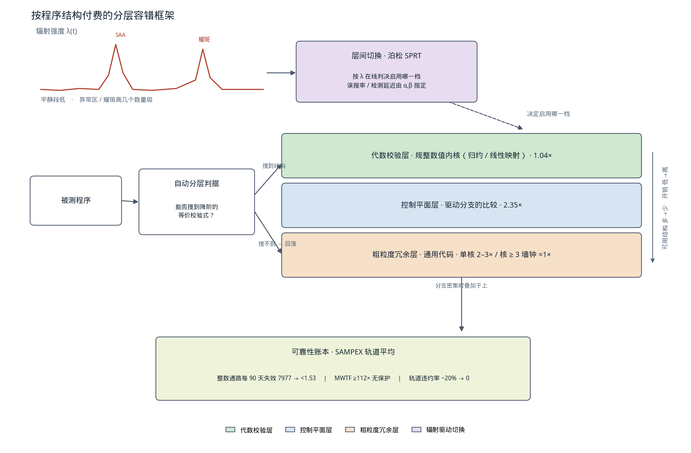

# 面向空天计算的自适应容错框架

## 整体方法
**现状：软件容错时间长；硬件容错面积大**
- 硬件 TMR 用面积换并行
- 软件 TMR 用时间换面积。

**主张：容错开销应和按程序结构相关**

基于该主张提出自动分层框架，搜得到降阶的等价校验式就进代数校验层，搜不到才回落粗粒度冗余层；

| 层 | 适用对象 | 做法 | 代价 | 效果 |
|---|---|---|---|---|
| 代数校验层 | 规整数值内核（环类；半环类仅末端检查） | 用降阶的等价校验量覆盖整段计算 | N=256 时 1.04× | 内核 SDC 清零，检出恢复 ~68% |
| 控制平面层 | 驱动分支的比较 | 比较条件三模 + 分支前多数决 | 单独 2.35× | 该类 SDC 63.8 → 0.0% |
| 粗粒度冗余层 | 无结构可用的通用代码 | 进程级复制 + 多数决 / 重执行 | 单核 2–3× 计算（零软件税）；核 ≥ 3 墙钟 ≈1× | SDC → 0；fork 版 DUE 亦 → ~0 |
| 层间切换 | 随辐射强度 | 泊松 SPRT 在线判决启用档位 | — | 检出 96.3%、延迟 3.13 min |

---

## 模块设计

### 代数校验层

- 机理
  - 规整数值内核满足代数结构，一个 O(n²) 的校验量就能覆盖 O(n³) 的计算，校验远比重算便宜。
  - 环类（矩阵乘 / 归约 / 线性映射）：用校验和，能检错并按 syndrome 定位纠错。
  - 半环类（min-plus 最短路等）：无加法逆元、校验和无定义，退而用结构性不等式（三角、子路径最优）做**末端完整性检查**——但覆盖面有限，见下。
- 适用判据
  - 环上能否搜到降阶的等价校验式：搜到才插桩，搜不到回落粗粒度冗余层。
- 效果

  | 内核 | 无保护 SDC% | 机制 | 结果 |
  |---|---|---|---|
  | 规整矩阵乘 A | 5.25 | 校验和 + 纠错 | SDC → 0.00，检出恢复 68.0% |
  | 规整矩阵乘 B | 9.00 | 校验和 + 纠错 | SDC → 0.00，检出恢复 68.8% |
  | 最短路 Floyd-Warshall | 12.25 | 不等式末端检查 | 结果态 SEU 97%，计算中故障仅 37% |

  - 校验和分支已在真实注错实测（矩阵乘，倍率随规模 O(1/n) 衰减，N=256 时 1.04×）。
  - 半环不等式分支（`experiments/semiring_check_kernel.c`，真实内核）**结论诚实为负/受限**：
    - 对**已沉淀结果**上的单比特翻转，三角检查检出 97%、误报 0，是近乎免费的末端完整性检查；
    - 但对 **O(n³) 计算过程中**的瞬态故障只检出 **37%**——min-plus 的 `min()` 会把多数被扰动的距离重新优化成"满足三角不等式但错误"的度量，检不出来；
    - 故它**不能替代半环类的计算保护**（那仍需粗粒度冗余），只能作末端的廉价补充。该类的覆盖缺口因此仍未真正补上。

### 控制平面层

- 机理
  - 数据值在写回点能被表决保护，但喂给分支的比较结果被分支直接消费、不进复制链。
  - 分支一旦走错，三份副本在错误路径上一致地算错，表决全票通过——这类从结构上覆盖不到。
- 做法
  - 只把驱动分支的比较及其操作数三模化，在分支前多数决，不做全程复制。
- 效果
  - 该类 SDC 63.8 → 0.0%；单独启用 2.35×，在 SDC / DUE / 开销三个轴上同时优于全程指令复制基线。

### 粗粒度冗余层

- 机理
  - 无结构可用的通用代码只能上冗余。以进程为单位整体复制，省去逐指令复制的表决网络与屏障。
  - 双模 ＋ 重执行：比对检出不一致后重跑，清掉算错（SDC），但崩溃（DUE）不治；三模进程隔离（fork）把崩溃也一起隔离掉。
- 做法
  - 进程级复制整段计算，输出端多数决；检到不一致则重执行或取多数值。
- 效果

  可靠性（6 个共有负载，与无保护同批对比）：

  | 方案 | SDC | DUE |
  |---|---|---|
  | 双模 ＋ 重执行 | → 0 | 基本不变（int 51→48、cast 69→66，崩溃不治） |
  | 三模 fork | → 0 | → ~0（最大 0.08） |

  开销（gemm，warmup + 中位/21 次，核数为真参数 taskset，脚本 `experiments/measure_coarse_scaling.py`）：

  - 串行（与核数无关）：DMR **2.00×**、TMR **3.00×** —— 零软件税，贴合 2×/3× 理论。
  - 墙钟随可用核数回落：

  | 可用核 | 1 | 2 | 3 | 4 | ≥6 |
  |---|---|---|---|---|---|
  | 三模 pthread× | 3.00 | 2.37 | 1.20 | 0.98 | 0.98 |
  | 三模 fork× | 3.19 | 2.52 | 1.07 | 1.05 | 1.04 |

  - 空闲核 ≥ 副本数(3) 时墙钟回落到 ≈1×（fork 比 pthread 多约 4%，进程 spawn 开销）。
  - fork 把 SDC 与 DUE 一起清零，不需按类别做逐类工程。
  - 故障模型：fork 的 DUE→~0 在"单事件瞬态"下测得（仅一份副本可被注入、每份带看门狗、投票在父进程）；共模 / 多副本击穿需另测。

### 层间切换（辐射驱动自适应）

- 机理
  - 在轨辐射强度随轨道变化：平静段低，南大西洋异常区与太阳耀斑段高几个数量级。
  - 全程高防护浪费开销，全程不防护在辐射段违约；按辐射强度在线切换防护档位。
- 建模：带积分约束的最优控制

  最小化全程开销，约束是整条轨道的期望失效 ≤ 任务预算 B：

  $$\min_{j(\cdot)}\ \int_0^T o_{j(t)}\,dt \quad\text{s.t.}\quad \int_0^T \lambda(t)\,e_{j(t)}\,dt \le B$$

  逐点最优（乘子 μ）与两档解析切换门限：

  $$j^{*}(t)=\arg\min_j\big(o_j+\mu\,\lambda(t)\,e_j\big),\qquad \lambda^{*}=\frac{o_1-o_2}{\mu\,(e_2-e_1)}$$

  协态沿最优轨迹恒定，由预算反解（阈值不手调，ε 由 B 推出）：

  $$\dot\mu=0,\qquad \mu=\mu(B):\ \int_0^T \lambda(t)\,e_{j^{*}(t)}\,dt = B$$

  符号：$o$ 开销，$e$ 残余失效率，$\lambda(t)$ 事件率，$B$ 任务失效预算，$\mu$ 协态（可靠性影子价格）。双模 $\lambda$ 下 $j^{*}$ 退化为阈值，已近最优。
- 做法
  - 对错误事件到达率做泊松 SPRT 序贯检测，误报率与检测延迟由 α、β 指定，取代拍定的"连续次数 ＋ 窗口计数"。
- 效果

  | 轨道 | 自适应开销× | 全程高防护× | 违约率（不防护 → 自适应） |
  |---|---|---|---|
  | LEO-SAMPEX | 1.12 | 1.64 | 18.7% → 0 |
  | SSO-Alsat1 | 1.00 | 1.64 | 21.4% → 0 |
  | GEO-耀斑 | 1.12 | 1.64 | 20.4% → 0 |

  - 切换判决本身：检出 90.0 → 96.3%、检测延迟 4.34 → 3.13 min。
- 资源价格视角（目标从墙钟换成能量）
  - 空闲核让墙钟回到 ~1×，但三副本的计算功耗照付——墙钟 1× 对应能量 >1×。航天真正受限的是能量（NASA HPSC：同等电量处理更多数据），所以目标应是能量。
  - 换目标后控制器：平静段用无防护；辐射段优先选能量最便宜的结构感知校验（代数校验层的 ABFT / 结果校验覆盖半数内核、能量 ~1×），只有无结构的内核才动用粗粒度（能量 2–3×）。

  | 轨道 | 时间目标墙钟× | 时间目标隐藏能量× | 能量目标能量× | 全程强防护能量× | 省能量 |
  |---|---|---|---|---|---|
  | LEO-SAMPEX | 1.00 | 1.06 | 1.03 | 1.64 | 37% |
  | SSO-Alsat1 | 1.00 | 1.07 | 1.04 | 1.64 | 37% |
  | GEO-耀斑 | 1.00 | 1.22 | 1.12 | 1.64 | 32% |

  - 诚实结论：拿墙钟当目标在耀斑段最多藏 22% 能量；直接按能量优化压回 1.12×，且仍省全程强防护 ~32–37%。能量的鲁棒性主要来自结构感知层覆盖了半数内核（~1× 能量），不是来自切换本身。脚本 `experiments/resource_pricing.py`。

---

## 评测与可靠性

- 注错框架
  - 注入器与保护策略解耦，覆盖 6 类故障点
    - 浮点 
    - 整数 
    - 类型转换
    - 访存
    - 地址
    - 比较分支
  - 涉及 4 种注入模式
    - 单比特均匀
    - 位域定向
    - 空间多比特
    - 时间连发
- 基准套件
  - 17 个负载取自开源实现
    - PolyBench/C 全套
    - OBPMark
    - PARSEC
    - KissFFT
    - COAST
- 任务级账本
  - SAMPEX 轨道平均下，整数通路每 90 天期望失效 7977 → <1.53
- 口径说明
  - DUE 数字基于 IR 级注入，对崩溃概率的绝对值有已知局限（SDC 口径不受影响）；fork 层的 DUE 宜配二进制级注入复核。

