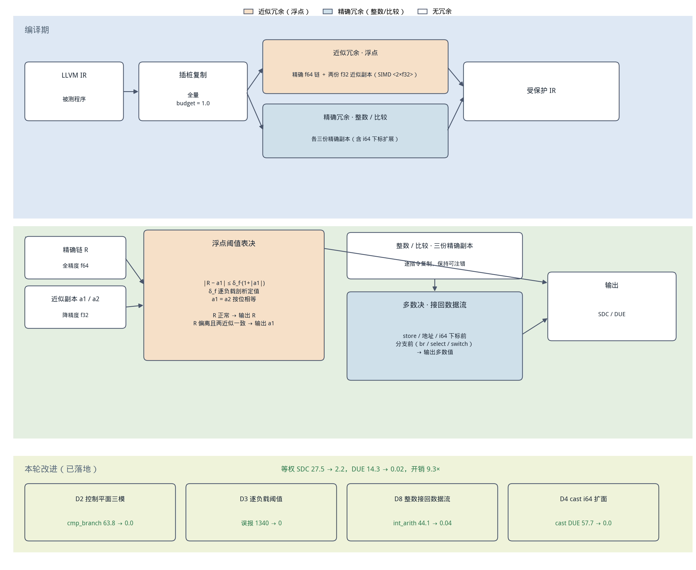

# 方法改进（26116）

## 方法

编译期全量插桩，运行期按类型分两条表决路。

- **浮点：精确 ＋ 两份近似的阈值表决。** 
    - 一份精确 f64 链 R，两份 f32 降精度副本打进SIMD。
    - 判据 `|R − a1| ≤ δ_f·(1+|a1|)`，R 偏离且两近似一致则判精确链故障、输出 a1。
- **整数 / i64 下标 / 比较：三份精确副本的多数决。** 
    - 逐指令复制三份精确副本，在边界多数决并把结果接回数据流。

| 判定点 | 取值 | 现状 |
|---|---|---|
| 表决阈值 δ_f | 逐负载剖析定值 | 已标定，误报归零 |
| 副本一致性 | a1 = a2 按位相等 | 已标定 |
| 整数覆盖类型 | i8 / i16 / i32 / i64 | 按类型枚举 |

## 做了什么

四处改动，等权 SDC 27.5 → 2.2、DUE 14.3 → 0.02，开销 9.3×：

- **控制平面三模**：复制喂给 br/select/switch 的比较及其操作数，分支前多数决（cmp_branch 清零）。
- **整数三模接回数据流**：表决值替换下游使用者，不再只用一条 InlineAsm 保活（int_arith 清零，开销反降）。
- **cast i64 扩面**：把 i32→i64 的下标扩展纳入三模，坏下标不再直接段错误（cast 崩溃清零）。
- **逐负载阈值**：表决阈值改逐负载剖析定值、副本一致性改按位相等（误报归零）。

